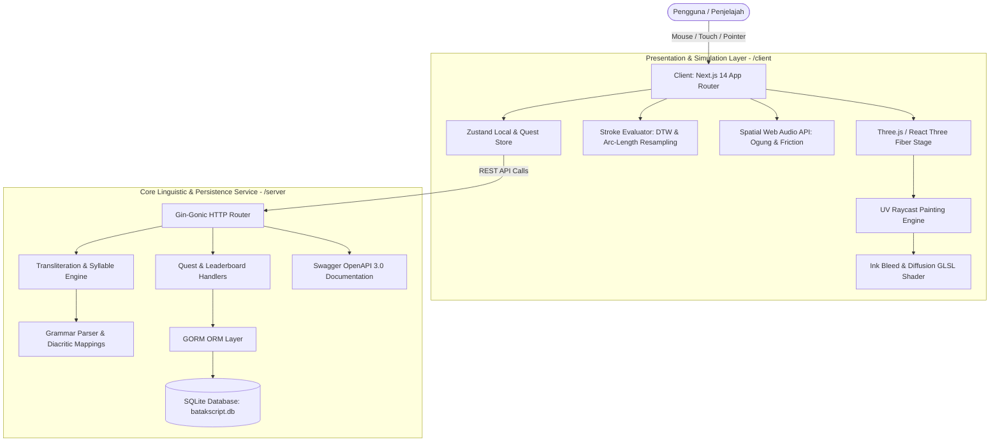
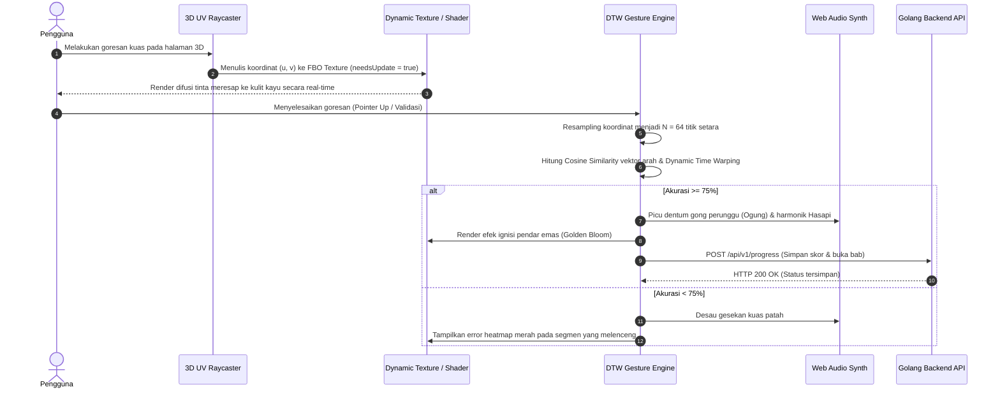

# ᯅ BatakScript 3D — World-Class Diegetic Experience #

> **BatakScript 3D** memadukan nilai arkeologis naskah kuno Batak (*Pustaha Laklak*) dengan teknologi grafis modern in-browser (*Three.js, WebGL/GLSL Shaders, Web Audio API, & Golang*).

---

## 📖 Ringkasan Proyek (Overview)

BatakScript 3D hadir untuk menyelesaikan masalah digitalisasi aksara tradisional yang umumnya kaku, monoton, dan sekadar berupa modul kuis pilihan ganda. Aplikasi ini memadukan nilai arkeologis naskah kuno Batak (**Pustaha Laklak**) dengan teknologi grafis modern in-browser.

Alih-alih memisahkan kanvas input 2D dengan tampilan 3D, BatakScript 3D mengadopsi **antarmuka diegetik (*in-world*)**, di mana pengguna menuliskan aksara menggunakan pena bambu digital langsung di atas lembaran kulit kayu pohon alim (*Aquilaria*) dalam ruang 3D. Tinta arang yang digoreskan meresap secara dinamis ke serat kayu menggunakan *custom fragment shader*, sementara kurva goresan dianalisis oleh algoritma komputasi geometri untuk memberikan umpan balik presisi secara real-time.

---

## ✨ Fitur Unggulan

### 1. 📜 Diegetic 3D Canvas & Direct UV Surface Painting
* **Interaksi Langsung pada Objek 3D:** Mengeliminasi pemisahan formulir web standar. Pengguna menggambar langsung pada permukaan halaman buku 3D menggunakan teknik *Raycasting UV Coordinate Mapping*.
* **Struktur Lipatan Akordeon Otentik:** Rekonstruksi 3D naskah Pustaha Laklak dengan struktur lipatan akordeon (*concertina fold*) multi-panel, engsel kulit fleksibel, dan sampul kayu berukir motif penolak bala Singasinga.
* **Simulasi Pencahayaan Ritual:** Tata cahaya lilin/obor berkedip (*flickering flame lighting*) dinamis, bayangan kontak berbasis kedalaman (*ContactShadows*), dan partikel abu dupa melayang (*atmospheric embers*).

### 2. 🖋️ GPU Ink Diffusion & Wood Absorption Shader
* **Capillary Bleed Physics:** Custom WebGL/GLSL Shader yang mensimulasikan penyerapan cairan getah/tinta arang ke dalam pori-pori kulit kayu kuno.
* **Material PBR Realistis:** Peta kekasaran (*roughness*) dan permukaan (*normal maps*) yang membiaskan cahaya secara akurat antara area basah tinta segar dan kayu kering lapuk.

### 3. 🎯 Validasi Goresan Dynamic Time Warping (DTW) & Resampling
* **Arc-Length Parameterization ($N = 64$):** Normalisasi goresan menjadi 64 titik berjarak seragam, membuat penilaian tidak terdistorsi oleh kecepatan pointer mouse atau jari.
* **Evaluasi Multidimensi:** Mengukur jarak Euclidean kurva, arah tangen vektor sudut ($\cos \theta$), dan deviasi urutan tarikan garis (*stroke order*).
* **Heatmap Presisi Interaktif:** Jalur goresan diberi warna gradien langsung:
  * 🟢 **Hijau Neon:** Presisi tinggi ($< 18\text{px}$).
  * 🟠 **Oranye Amber:** Deviasi moderat ($18\text{px} - 35\text{px}$).
  * 🔴 **Merah Crimson:** Melenceng dari template ($> 35\text{px}$).

### 4. 🔤 Deterministic Syllabic Transliteration Engine
* **Kepatuhan Aturan Surat Batak Toba:**
  * **19 Ina ni Surat:** Karakter induk dengan vokal inheren /a/ (*a, ha, ma, na, ra, ta, ba, pa, ja, da, ga, sa, wa, ya, nya, ca, nga, i, u*).
  * **Anak ni Surat:** Penempatan diakritik vokal atas (*Haborotan* /i/), bawah (*Sihorhor* /u/), kanan (*Hatadingan* /e/), dan belakang (*Hatalingan* /o/).
  * **Pangolat (Virama):** Penanganan pemati vokal otomatis pada konsonan akhir suku kata tertutup.
  * **Hamisaran:** Otomasi penempatan konsonan sengau nasal akhir /ng/.
* **X-Ray Structural Inspector:** Anatomi interaktif yang membedah tiap komponen pembentuk aksara saat disorot kursor.

### 5. 🌌 Babad Pustaha Quest & Kalender Porhalaan
* **Naratif Gamifikasi Kuno:** Pemecahan misteri naskah Datu Bolon dalam 5 babak bertingkat.
* **Roda Horoskop Porhalaan:** Modul interaktif membaca sistem penanggalan astrologi Batak kuno berbasis konstelasi bintang Orion dan Pleiades untuk membuka bab mantra berikutnya.

### 6. 🔊 3D Spatial Audio & Generative Folk Synthesis
* **Web Audio API Tanpa Aset Eksternal:** 100% audio sintetis terprogram secara prosedural bebas latency.
* **Binaural Spatial Panning:** Suara goresan kuas bambu dan deru lentera bergerak di ruang 3D mengikuti orientasi sudut pandang pengguna.
* **Resonansi Gamelan Ogung:** Dentuman sub-bass gong perunggu tradisional dan tangga nada pentatonis Hasapi yang berdering lembut saat modul berhasil diselesaikan.

---

## 🏗️ Arsitektur Sistem & Diagram

### High-Level Architecture (Monorepo)



### 🔄 Pipeline Evaluasi Goresan (DTW & Shader Mirroring)



---

## 📁 Struktur Direktori Monorepo

```text
ppw-2026-week6-12S24012/
├── client/                     # Frontend Application (Next.js + R3F)
│   ├── public/                 # Aset statis & font Batak Unicode
│   ├── src/
│   │   ├── app/                # Next.js App Router (Layout & Pages)
│   │   ├── components/
│   │   │   ├── 3d/             # Komponen Three.js / React Three Fiber
│   │   │   │   ├── PustahaScene.tsx   # Panggung utama 3D, lighting, dan kamera
│   │   │   │   ├── PustahaBook.tsx    # Model akordeon 3D, engsel, & wood shaders
│   │   │   │   └── PorhalaanDisc.tsx  # Roda astrologi kosmis Batak kuno
│   │   │   ├── canvas/         # Komponen penanganan pointer & UV Raycasting
│   │   │   ├── hud/            # Floating Glassmorphism HUD Dock & Menu
│   │   │   └── quest/          # Modul Babad Quest teka-teki naskah
│   │   ├── lib/
│   │   │   ├── audio.ts        # Web Audio API sintetis (Ogung, Hasapi, Brush)
│   │   │   ├── strokeEvaluator.ts # Algoritma DTW & $1 Unistroke Resampling
│   │   │   └── apiClient.ts    # REST Client penghubung ke backend Go
│   │   └── types/              # Kontrak tipe TypeScript (Glyphs, Quests, Scores)
│   ├── package.json
│   ├── tailwind.config.ts
│   └── tsconfig.json
├── server/                     # Backend API Service (Golang)
│   ├── handler/                # HTTP Route Handlers
│   │   ├── glyph_handler.go        # Endpoint katalog glyph Batak
│   │   ├── transliterate_handler.go # Endpoint parser alih-aksara Latin-Batak
│   │   ├── progress_handler.go     # Endpoint progres latihan & leaderboard
│   │   └── swagger_handler.go      # OpenAPI 3.0 Documentation server
│   ├── service/                # Logika bisnis & aturan gramatika Batak
│   │   └── transliteration_engine.go # Tokenizer silabel deterministik
│   ├── repository/             # Lapisan persistensi basis data (GORM)
│   ├── model/                  # Entitas skema database SQLite
│   ├── batakscript.db          # File basis data lokal SQLite
│   ├── go.mod
│   ├── go.sum
│   └── main.go                 # Entry-point server Golang
├── PRD.md                      # Product Requirement Document acuan agen
└── README.md                   # Dokumentasi teknis repositori
```

---

## 🚀 Panduan Instalasi & Menjalankan Proyek

### Prasyarat Sistem
* **Node.js:** Versi 18.17.0 atau lebih tinggi
* **Go (Golang):** Versi 1.22.0 atau lebih baru
* **Git:** Terpasang pada terminal CLI

### Langkah 1: Kloning Repositori
```bash
git clone https://github.com/ChoqySirait/BatakScript---3D.git
cd BatakScript---3D
```

### Langkah 2: Menjalankan Backend Service (Golang)
Buka terminal pertama:
```bash
# Masuk ke direktori backend
cd server

# Unduh seluruh dependensi Go
go mod tidy

# Jalankan server
go run main.go
```
* Server backend akan aktif di `http://localhost:8080`.
* Dokumentasi interaktif Swagger UI dapat langsung diakses di `http://localhost:8080/swagger`.

### Langkah 3: Menjalankan Frontend Client (Next.js)
Buka terminal kedua:
```bash
# Masuk ke direktori frontend
cd client

# Pasang paket dependensi
npm install

# Jalankan server pengembangan
npm run dev
```
Buka browser Anda dan akses aplikasi di `http://localhost:3000`.

---

## 📡 Spesifikasi API (Golang Gin)

**Base URL:** `http://localhost:8080/api/v1`

| Metode | Endpoint | Deskripsi | Status |
|:------:|:---------|:----------|:------:|
| `GET`  | `/health` | Pemeriksaan kesehatan layanan (*health check*) | `200 OK` |
| `GET`  | `/swagger` | Antarmuka dokumentasi OpenAPI 3.0 | `200 OK` |
| `GET`  | `/glyphs` | Katalog 19 Ina ni Surat & 5 Anak ni Surat lengkap | `200 OK` |
| `POST` | `/transliterate` | Alih aksara string alfabet Latin menjadi Unicode Batak | `200 OK` |
| `POST` | `/progress` | Menyimpan akurasi goresan dan memperbarui status bab | `201 Created` |
| `GET`  | `/leaderboard` | Mengambil 10 skor tertinggi kuis uji kecepatan | `200 OK` |
| `POST` | `/quest/progress` | Validasi kunci aksara untuk membuka segel babad naskah | `200 OK` |

#### Contoh Payload Transliterasi:
```bash
curl -X POST http://localhost:8080/api/v1/transliterate \
  -H "Content-Type: application/json" \
  -d '{"text": "horas batak toba"}'
```

#### Respon JSON:
```json
{
  "original": "horas batak toba",
  "result": "ᯂᯬᯒᯘ᯲ ᯅᯖᯂ᯲ ᯖᯬᯅ",
  "tokens": [
    {
      "syllable": "ho",
      "batak": "ᯂᯬ",
      "components": {
        "base": "ha",
        "diacritic": "hatalingan",
        "virama": false
      }
    },
    {
      "syllable": "ras",
      "batak": "ᯒᯘ᯲",
      "components": {
        "base": "ra",
        "final_consonant": "sa",
        "virama": true
      }
    }
  ]
}
```

---

## 📜 Protokol Git & Standar Pengembangan

Repositori ini mematuhi spesifikasi [Conventional Commits](https://www.conventionalcommits.org/en/v1.0.0/) untuk menjaga riwayat repositori tetap teratur:

* `feat(<scope>)`: Penambahan fitur fungsionalitas baru
* `fix(<scope>)`: Perbaikan bug atau galat kalkulasi
* `chore(<scope>)`: Konfigurasi dependensi, build tooling, struktur file
* `refactor(<scope>)`: Optimasi kode tanpa mengubah perilaku fungsional
* `docs(<scope>)`: Pembaruan dokumentasi naskah atau README

---

## ⚖️ Lisensi & Hak Budaya

Proyek ini dirilis di bawah lisensi [MIT License](LICENSE).

Karakter aksara mengacu pada standar Unicode resmi Surat Batak (`U+1BC0` hingga `U+1BFF`). Seluruh materi teks tradisi dan pepatah (*Umpasa*) bersumber dari warisan sastra lisan masyarakat Batak Toba yang dipersembahkan untuk tujuan edukasi dan pelestarian kebudayaan nusantara.
